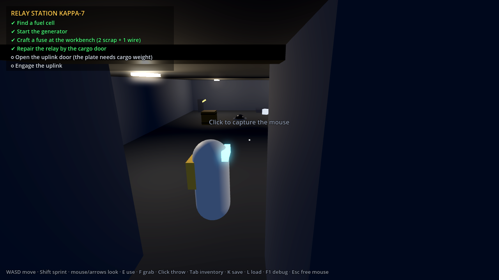
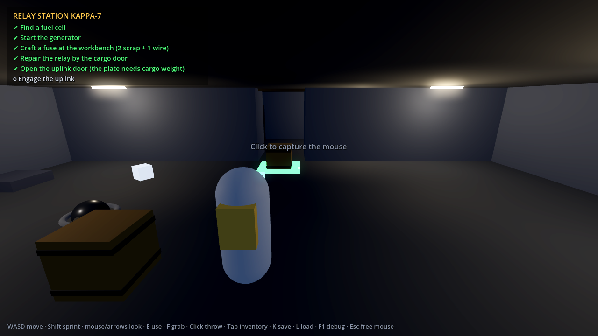
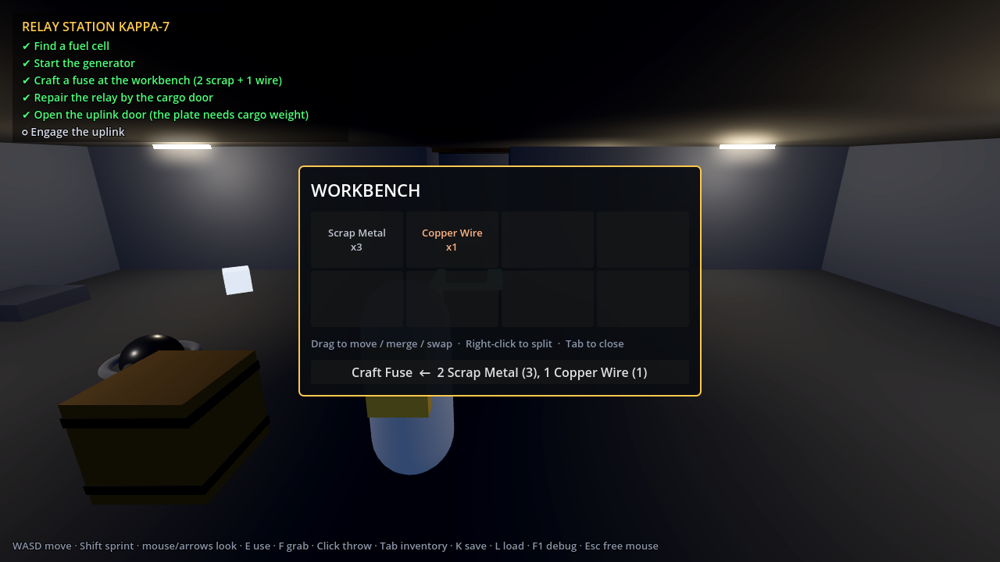
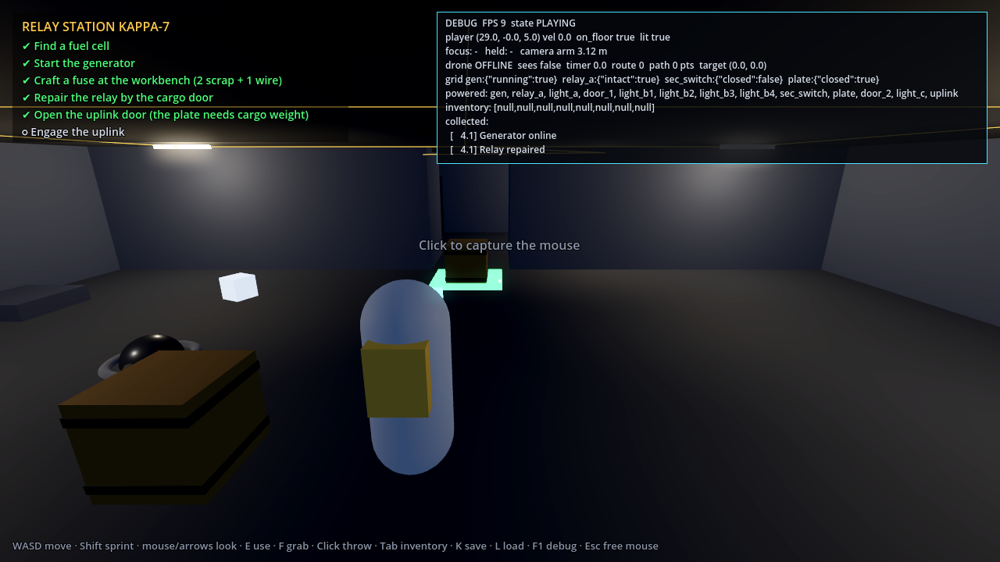

# Relay Station

**Third-person 3D systems sandbox — Godot 4.3+ · GDScript · playable in the browser**

Station Kappa-7 is dark. Find a fuel cell, start the generator, craft a fuse to repair the relay, get past (or switch off) the security drone, weigh down the cargo plate with a crate and engage the uplink. Each step is a different system acting on the others.



> **Play:** _itch.io link here_ · **Controls:** WASD move · Shift sprint · mouse / arrows look · E use · F grab / drop · click throw · Tab inventory · K save · L load · F1 debug · R restart · Esc free the mouse

---

## What this project demonstrates

This is the 3D companion to [Signal Breach](https://github.com/jsortizq/signal-breach) (turn-based logic) and [Overload Protocol](https://github.com/jsortizq/overload-protocol) (real-time 2D action). It covers the areas where most production bugs live:

| Area | Implementation |
|------|----------------|
| **3D character & camera** | `CharacterBody3D` third-person controller, `SpringArm3D` camera that collides with walls and ceiling, over-the-shoulder offset, camera-relative movement |
| **Interaction** | Crosshair ray from the camera, with reach measured from the character. Proximity fallback with a line-of-sight check, so nothing can be used through walls |
| **Physics props** | `RigidBody3D` crates you can grab, carry and throw. Pressure plate (`Area3D`) that only counts rigid bodies heavier than 20 kg |
| **Power network** | Graph solver (`PowerGrid`): generators, relays, switches and consumers, including a wiring **loop**. Recomputed from scratch on every change |
| **Inventory & crafting** | Slot inventory with stacking, merge, swap and split. Native drag & drop UI. Atomic crafting. Items and recipes are `Resource` files (`.tres`) |
| **Navigation** | The navmesh is **generated from the level grid**. Each door is a separate `NavigationRegion3D` that is disabled while the door is closed, so the drone re-plans its route |
| **AI** | Drone FSM (OFFLINE / PATROL / SUSPICIOUS / ALERTED) driven by `NavigationAgent3D`, with a vision cone plus line of sight. **Light matters**: 9 m range in lit rooms, 4.5 m in the dark |
| **Save / load** | Versioned JSON with a v1 → v2 migration. Stores source state only; derived state is recomputed. Stable ids for everything |
| **QA tooling** | F1 overlay showing power wires (energised in yellow), the drone's nav path and vision cone, and the FSM, inventory and grid flags. Acceptance scenarios and a headless suite of 43 tests in CI |
| **Tasks** | A [`tasks/`](tasks/) folder of bug and feature challenges written for AI-evaluation work |

## Systems interaction

```
fuel cell ─▶ generator ─▶ relay (needs fuse) ─▶ door 1 ─▶ room B
                │                │
                ▼                ▼
             light A      ring of 4 lights (loop) ─▶ security lever ─▶ drone dock ─▶ drone
                                 │
                                 ▼
                       pressure plate (crate ≥ 20 kg) ─▶ door 2 + light C ─▶ uplink
```

- **Inventory → Power:** the fuel cell and the crafted fuse are consumed by machines. Removing the fuel cell gives it back and shuts everything down.
- **Power → Navigation → AI:** a door with no power closes, disables its nav region, and the drone's path to that room becomes unreachable.
- **Power → AI:** cutting the security lever takes the drone offline, but the cargo bay lights stay on. Cutting the main line instead darkens rooms, which shortens the drone's sight to 4.5 m.
- **Physics → Power:** only a crate is heavy enough for the plate. If you take the crate off, the uplink door closes behind you.

## Architecture

```
scripts/
  core/    game.gd: composition root (systems, rebuildable World node, flow, objectives)
  power/   power_grid.gd: pure graph solver (unit-tested without nodes)
  items/   item_data.gd / recipe.gd (Resources), inventory.gd (pure), item_db.gd
  world/   level_builder.gd (JSON → geometry, navmesh, entities), machines, fixtures, props
  player/  player.gd: controller, camera, interaction, grab/throw
  ai/      drone.gd: FSM + NavigationAgent3D + vision
  save/    save_system.gd: capture / apply / migrate
  ui/      hud.gd, inventory_ui.gd (drag & drop + crafting), debug_overlay.gd
levels/station.json     map, power graph and entities
resources/              items/*.tres, recipes/*.tres
tests/                  43 tests: logic, save/load, 3D physics, navigation, AI, full walkthrough
tools/                  scenario.gd (acceptance checks), capture.gd (screenshots)
```

The game logic (power, inventory, saves) has no nodes, so it is tested as plain code. The world tests run real physics frames, each in its own `SubViewport` with `own_world_3d`, so every test gets a private physics space and navigation map.

## Known edge cases handled

| Edge case | Solution | Covered by |
|-----------|----------|------------|
| A wiring loop keeps itself powered after the generator stops | Full recompute from the running generators on every change, never incremental | `test_loop_loses_power_when_source_stops`, `scenario generator_shutdown` |
| A broken relay should look energised but pass nothing on | "Energised" and "conducts" are separate properties | `test_broken_relay_is_energised_but_blocks` |
| Save / load duplicates collected items | Pickups are tracked by their stable level-file id, never by node name or instance id | `test_save_load_cannot_duplicate_items`, `scenario save_duplication` |
| Saved derived state disagrees with source state (door open, no power) | Doors and lights are not saved; they are recomputed from the grid flags after loading, and doors snap to place | `test_derived_state_is_recomputed_after_load` |
| Old save files | `version` field + `migrate()`; newer versions are rejected with a message | `test_v1_save_is_migrated`, `test_newer_save_version_is_rejected` |
| Crafting with a full inventory | Space check on a copy *after* the inputs are taken out, then all-or-nothing | `test_craft_can_use_slots_freed_by_its_inputs`, `test_craft_is_atomic_when_output_does_not_fit` |
| Drag & drop loses or creates items | Merging leaves the remainder in the source slot. A 600-step random fuzz checks item counts and stack limits | `test_random_operations_never_create_or_destroy_items` |
| Navmesh holes and door gaps | One quad per grid cell with shared vertices; door regions share edges with their neighbours, so no re-bake is needed | `test_closed_door_forces_reroute` |
| Third-person camera clipping into walls | `SpringArm3D` collides with walls and the ceiling; the character model hides when the camera is pushed into it | `test_camera_arm_shortens_against_walls` |
| Using things through walls | The ray stops at walls (machines are on the world layer too); the proximity fallback checks line of sight | `test_cannot_interact_through_walls` |
| A carried crate snags and tunnels | Carrying drives velocity, not position; the crate is dropped if it falls more than 2.5 m behind | `test_grab_carry_and_throw` |
| `.tres` loaded during a class-reference cycle comes back as plain `Resource` | `ItemDB` loads items lazily on first use instead of `const preload()` | every inventory test |
| `.tres` files are remapped in exported builds | Explicit path list instead of scanning the folder | — |

## Running it

```bash
godot --headless --path . --import
godot --headless --path . --script res://tests/run_tests.gd            # 43 tests
godot --headless --path . --script res://tools/scenario.gd -- save_duplication
godot --headless --path . --script res://tools/scenario.gd -- generator_shutdown
```

### Web export (itch.io)

*Project → Export → Web*, then zip `build/web/` and upload it as an HTML game: 1280×720 viewport, SharedArrayBuffer **off**. Click the game to capture the mouse.





## License

MIT
